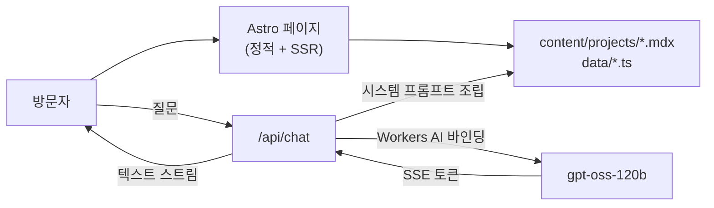

# decembaek.com

백승규의 개인 포트폴리오 사이트입니다. 개발자의 이력을 "릴리스 노트" 형식으로 보여주고, 사이트 안의 AI 챗봇이 프로젝트와 경력에 대한 질문에 답합니다.

**[decembaek.com](https://decembaek.com)** · 백승규([decembaek](https://github.com/decembaek)) · 개인 프로젝트 · 단독 설계·개발

## 무엇을 보여주나

| 섹션 | 내용 |
| --- | --- |
| readme | 소개, 일하는 방식 |
| changelog | 2020년부터의 경력·프로젝트 이력을 버전 형식으로 정리 |
| projects | 프로젝트 목록과 상세 케이스 스터디 (`/projects/<slug>/`) |
| package.json | 주로 쓰는 기술 스택 |
| writing | 블로그 글 목록 |
| /now | 지금 하고 있는 일 |
| contact | 이메일, GitHub, RSS, `curl`로 호출할 수 있는 `/hi` API |
| decembaek-bot | 사이트 데이터를 근거로 답하는 AI 챗봇 |

## 개발한 내용

### 데이터 한 곳에서 사이트와 챗봇을 함께 갱신

프로젝트는 `src/content/projects/*.mdx`, 경력은 `src/data/changelog.ts`, 스택은 `src/data/deps.ts`에 둡니다.
페이지는 이 파일들로 렌더링되고, 챗봇의 시스템 프롬프트도 같은 파일로 조립합니다(`src/lib/system-prompt.ts`).
그래서 프로젝트를 하나 추가하면 목록, 상세 페이지, RSS, 챗봇 답변이 함께 바뀝니다.

### Workers AI 챗봇과 스트리밍

`/api/chat`은 Cloudflare Workers AI 바인딩으로 `@cf/openai/gpt-oss-120b`를 호출합니다.
모델의 SSE 응답을 서버에서 읽어 토큰만 골라 다시 스트리밍하므로, 화면에는 답변이 생성되는 대로 표시됩니다.

- 모델 계열마다 다른 이벤트 형식(`response` 필드, OpenAI 호환 `choices[].delta`)을 모두 처리
- 추론(reasoning) 토큰은 사용자에게 보내지 않음
- 추론 토큰도 출력 한도에 포함되는 점을 고려해 `max_tokens`를 768로 조정
- API 키 없이 Workers AI 바인딩으로 호출해 키 관리가 필요 없음

### 콘텐츠 스키마

`src/content/config.ts`에서 Zod로 프로젝트 frontmatter를 검증합니다.
목록 카드에 필요한 필드(이름, 상태, 스택, 태그, 지표)는 필수이고, 상세 페이지 섹션은 모두 선택이라 간단한 항목으로 시작해 케이스 스터디로 키울 수 있습니다.

### 그 밖의 기능

- Pagefind로 빌드 시 정적 검색 인덱스 생성, 첫 검색 때 지연 로딩
- RSS 피드(`/rss.xml`)
- `/hi` 엔드포인트: GET·POST 모두 연락처 JSON 반환, CORS 허용

## 구조



## 기술 구성

| 기술 | 용도 |
| --- | --- |
| Astro 4 (hybrid output) | 정적 페이지와 SSR API 라우트를 함께 사용 |
| React 18 | 프로젝트 필터, 검색, 챗봇, 터미널 UI 같은 인터랙티브 컴포넌트 |
| MDX + Zod 스키마 | 프로젝트 케이스 스터디 콘텐츠 |
| Cloudflare Workers | 배포와 서버 실행 환경, 커스텀 도메인 |
| Workers AI | 포트폴리오 챗봇 모델 호출 |
| Pagefind | 정적 사이트 검색 |

## 디렉터리

```text
src/
  content/projects/   프로젝트 케이스 스터디 (MDX)
  data/               경력(changelog), 스택(deps), 사이트 정보
  lib/system-prompt.ts  챗봇 시스템 프롬프트 조립
  pages/
    api/chat.ts       Workers AI 스트리밍 챗봇 API
    hi.ts             연락처 JSON API
    projects/         프로젝트 상세 페이지
    writing/          글 목록
  components/         Astro·React 컴포넌트
wrangler.toml         Workers 설정, 커스텀 도메인, AI 바인딩
```

## 로컬 실행

```bash
npm install
npm run dev        # Astro 개발 서버 (챗봇은 AI 바인딩이 없어 동작하지 않음)
npm run preview    # wrangler dev — 빌드 결과를 Workers 런타임에서 실행, 챗봇 포함
npm run deploy     # 빌드 + 검색 인덱스 생성 + Cloudflare 배포
```

챗봇을 로컬에서 쓰려면 Cloudflare 계정에 로그인된 `wrangler`가 필요합니다.
